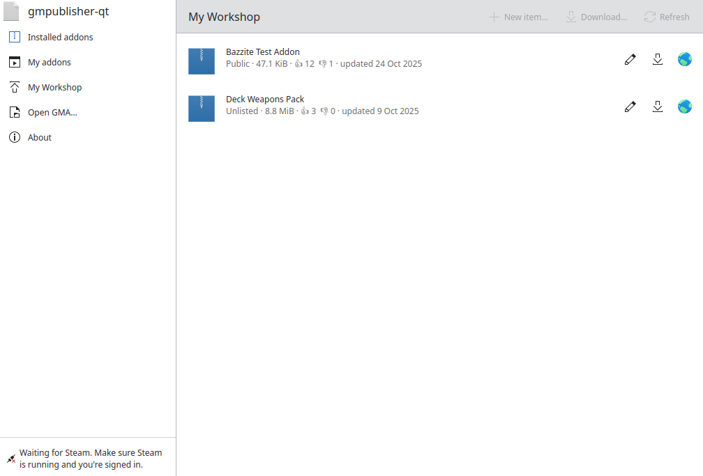
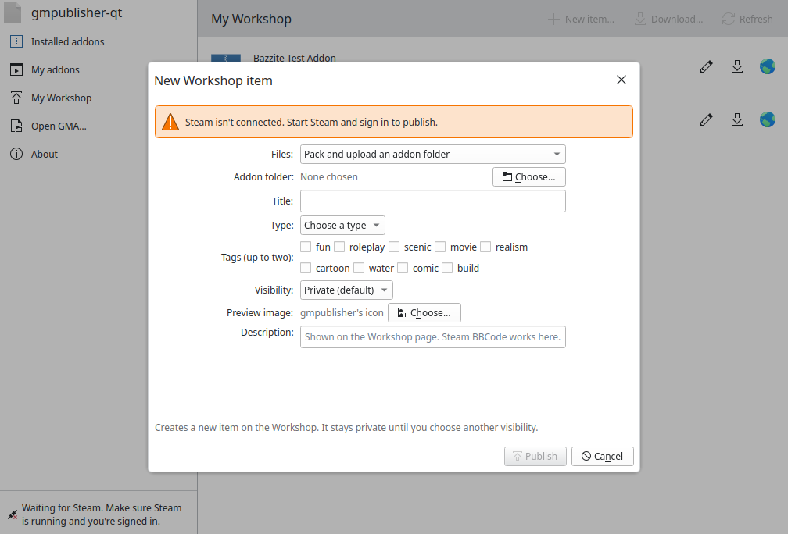
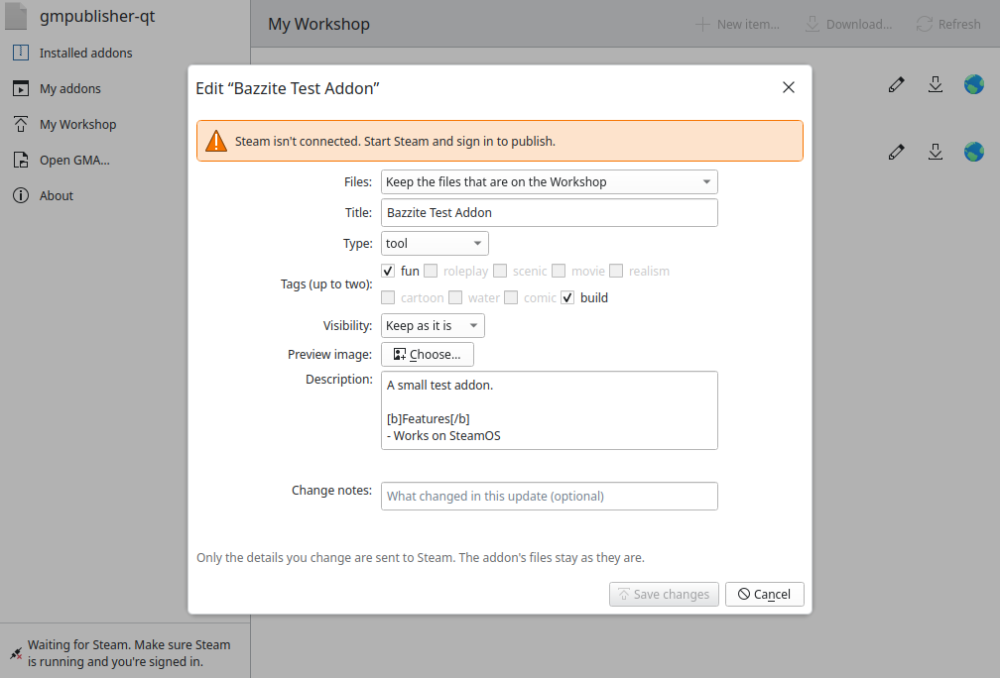
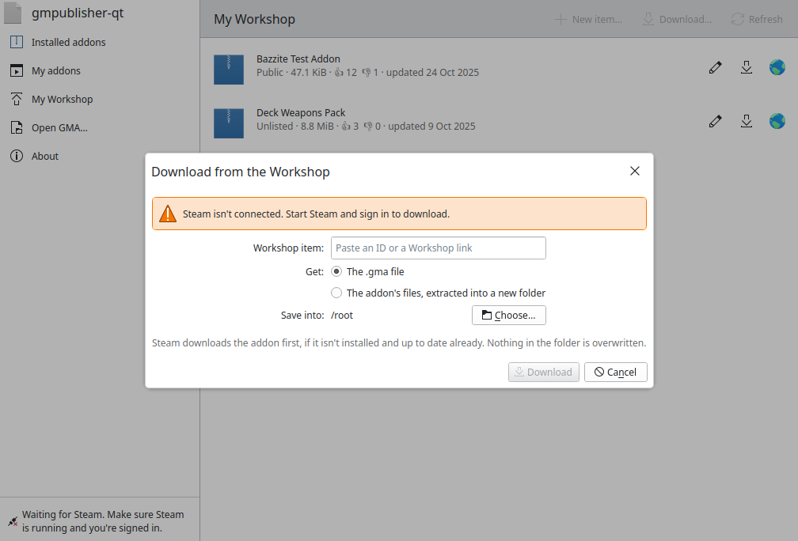
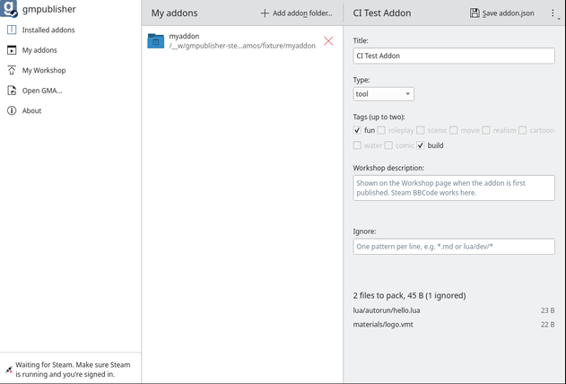
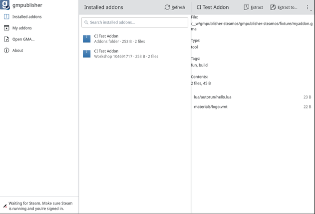

<p align="center">
  
</p>

<h1 align="center">gmpublisher · Steventechno Edition</h1>

<p align="center">
  <b>Publish, update and unpack Garry's Mod Workshop addons on Linux.</b><br>
  A native Qt rewrite of gmpublisher, made for SteamOS, Bazzite and KDE Plasma.
</p>

<p align="center">
  <a href="../../releases/latest"></a>
  
  
</p>

<p align="center">
  
</p>

---

## Why this exists

The original [gmpublisher](https://github.com/WilliamVenner/gmpublisher) is a Tauri app that needs WebKitGTK, which you can't install on a read-only system like SteamOS or Bazzite. This edition is a ground-up rewrite in **Rust and Qt 6 / KDE Kirigami**. It runs on the libraries Plasma already ships, so it fits in on the Steam Deck's Desktop Mode and needs no `sudo`, no `steamos-readonly disable` and no Distrobox.

## Features

### My Workshop
The app opens on **My Workshop**, a list of every addon you've published with its preview, visibility, size, votes and last update. Click an item to open it in the Steam client, or use the globe button to open it in your browser.

### Create and update Workshop items
- **New item…** packs an addon folder into a GMA and uploads it as a new Workshop item.
- The **pencil** button on any item edits its title, type, tags, visibility, preview image and description. You can upload new files from a folder, or keep the files that are already on the Workshop and only change the details.
- New items start out **Private**, so nothing goes public until you choose to. Updates keep the item's current visibility unless you change it.
- Change notes, a custom preview image (PNG, JPEG or GIF up to 1 MiB), and Steam BBCode descriptions are all supported.
- Upload progress follows each Steam stage, and if uploading to a brand-new item fails, the empty item is cleaned up for you.

<p align="center">
  
  
</p>

### Download and extract from the Workshop
Paste any Workshop ID or link, then save the `.gma` file or have it extracted straight into a new folder. The download button on your own items does the same. Nothing in the target folder is ever overwritten.

<p align="center">
  
</p>

### My Addons
Keep your addon folders in one place. Edit each addon's `addon.json` (title, type, tags, Workshop description and ignore patterns), see exactly which files will be packed, then **Pack GMA** or publish it. Each folder remembers which Workshop item it belongs to.

### Installed addons and GMA files
Browse and search the addons Garry's Mod has installed, open any `.gma`, look at its contents and extract it wherever you like.

<p align="center">
  
  
</p>

### Plays well with your desktop
- `.gma` files open in gmpublisher-qt, and Dolphin gets right-click actions to **extract a GMA** or **open a folder as a Garry's Mod addon** (tarball install).
- A command line for scripts and the terminal, shown below.

## Download

Grab the latest build from the **[Releases page](../../releases/latest)**.

| File | Best for |
| --- | --- |
| `gmpublisher-qt-x86_64.AppImage` | **SteamOS and Bazzite (recommended).** A single file that uses your desktop's Qt 6 and Kirigami. |
| `gmpublisher-qt-x86_64.flatpak` | If you prefer Flatpak. It brings its own KDE runtime from Flathub. |
| `gmpublisher-qt_linux_x86_64.tar.gz` | A per-user install with a menu entry and Dolphin right-click actions. |

### AppImage

Switch to **Desktop Mode**, download the AppImage, then in Dolphin right-click it, choose **Properties → Permissions**, tick **Is executable** and double-click it. Or from a terminal:

```sh
chmod +x gmpublisher-qt-x86_64.AppImage
./gmpublisher-qt-x86_64.AppImage
```

On Bazzite you can also open it with **Gear Lever** to add it to your app menu.

### Flatpak

```sh
flatpak install --user gmpublisher-qt-x86_64.flatpak
flatpak run io.github.ffseestevanli_oss.gmpublisher
```

If Flatpak asks where to find the KDE runtime, add Flathub first:

```sh
flatpak remote-add --user --if-not-exists flathub https://dl.flathub.org/repo/flathub.flatpakrepo
```

> [!NOTE]
> Talking to Steam from inside the Flatpak sandbox is the least tested part of this release. If the Flatpak keeps saying it's waiting for Steam, use the AppImage for Workshop work and please [open an issue](../../issues).

### Tarball

```sh
tar -xzf gmpublisher-qt_linux_x86_64.tar.gz
./gmpublisher-qt/install.sh
```

This installs for your user only, with no root. Run `./gmpublisher-qt/install.sh --uninstall` to remove it.

## Before you start

- **Steam must be running and signed in** for anything Workshop related. Browsing, packing and extracting GMA files work without it.
- Use it in **Desktop Mode**. It isn't designed for Game Mode.
- Outside of KDE Plasma, install your distro's Qt 6 Kirigami package (`kf6-kirigami` on Fedora, `kirigami` on Arch).
- If the AppImage won't start with a FUSE error, run it with `--appimage-extract-and-run`.

## Command line

```text
gmpublisher-qt                         open the app
gmpublisher-qt FILE.gma                open a GMA in the app
gmpublisher-qt FOLDER                  open an addon folder to edit, pack or publish
gmpublisher-qt list FILE.gma           list the files in a GMA
gmpublisher-qt extract FILE.gma [DIR]  extract a GMA (default: a new folder next to it)
gmpublisher-qt pack FOLDER [OUT.gma]   pack an addon folder using its addon.json
```

## Building from source

The rewrite lives in [`native/`](native): `native/core` handles GMA reading and writing, and `native/app` is the Qt/Kirigami app. You need Rust and the Qt 6 development packages (on Debian/Ubuntu: `qt6-base-dev qt6-declarative-dev qmake6 libgl-dev`), plus Kirigami at runtime.

```sh
cd native
cargo test --release
cargo build --release
./target/release/gmpublisher-qt
```

CI in [`.github/workflows/native.yml`](.github/workflows/native.yml) builds the AppImage, Flatpak and tarball, and smoke-tests them on Fedora and Arch. The Flatpak manifest is in [`native/packaging/flatpak`](native/packaging/flatpak).

The original Tauri version of gmpublisher is still in this repository (`src-tauri/`, `app/`) for reference, but it is no longer what gets released.

## Credits


**gmpublisher was created by [William Venner](https://github.com/WilliamVenner), and all credit for the original goes to him and its contributors.** This edition is an independent, Linux-first rewrite based on [the original gmpublisher](https://github.com/WilliamVenner/gmpublisher), maintained by Steventechno.

It is released under the same [GPL-3.0 license](LICENSE).
